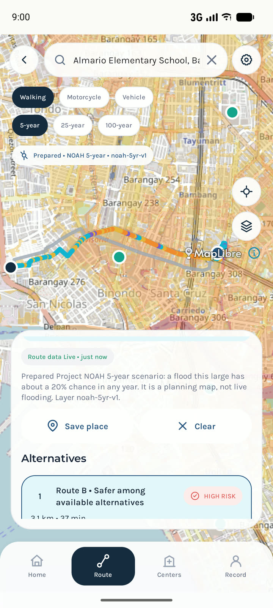
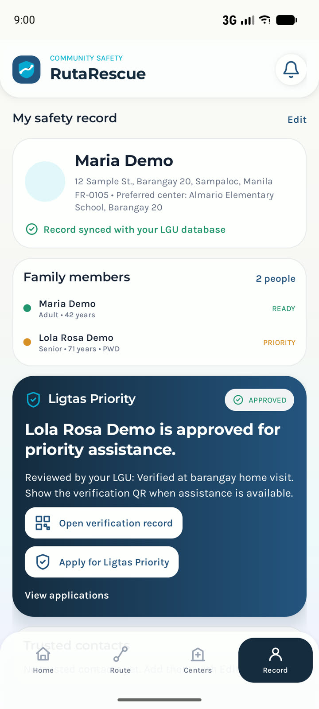

# RutaRescue

A flood-preparedness and safer-route app for Metro Manila, built as a native Android app in Java and XML.

> RutaRescue supports decisions; it never calls a route "safe", and in an emergency you should call 911.

## Screens

Real screens from the Android emulator, using made-up demo data.

| Home | Ranked routes | Why this route |
|:---:|:---:|:---:|
|  |  |  |
| **My Record** | **LGU reviews** | **LGU flood map** |
|  |  |  |

All 18 captured screens are in [`docs/demo/screens`](docs/demo/screens).

---

## The concept

- **Problem:** Floods cut off roads, and residents rarely know which route to an evacuation center is least exposed.
- **Idea:** The app checks each route against official flood-hazard maps and ranks the options by risk.
- **Users:** Residents plan routes and keep a family record, while LGU staff publish advisories and verify data.

## What residents can do

- Keep a family evacuation record that works offline.
- Compare up to three routes against the 5-, 25- and 100-year flood scenarios.
- Find evacuation centers that the LGU has verified.
- Apply for Ligtas Priority assistance and show its status as a QR code.

## What LGU staff can do

- Publish flood advisories.
- Review Ligtas Priority applications.
- Report road closures on the map.
- Confirm whether bridges and tunnels are open.
- Import and verify evacuation-center data.

---

## How the code works

### Startup

- `RutaRescueApp` creates one `AppContainer`, which builds every repository, service and route provider in one place.

### Sign-in and roles

- `AuthService` signs the user in with Firebase Auth.
- `SessionManager` loads the user's profile and role from Firestore.
- `MainShellActivity` shows the resident tabs or the LGU tabs based on that role.

### Family record

- `FamilyRecord` and `FamilyMember` check every value through `RecordValidator` before it is stored.
- `FamilyService` saves the record to Firestore and mirrors it to `family_records.txt` (`FamilyTextFileStore`).
- `SystemStateStore` updates `system.dat` with the last record number.

### Finding a safer route

1. `SafeRouteFragment` calls `RouteService.findRoutes()` on a background thread.
2. Online, `FallbackRouteProvider` asks TomTom first and falls back to OpenStreetMap (OSRM).
3. Offline, `CachedRouteProvider` reuses routes saved by `RouteCacheStore`.
4. `RouteSampler` cuts each route into 10 m samples.
5. `RiskEngine` runs five `RiskRule`s on each sample: `ClosureRule`, `TunnelRule`, `BridgeRule`, `UnknownStructureRule`, then `SurfaceRule`.
6. `RouteRanker` puts open routes first, then the lowest hazard, the shortest flooded distance, the fewest unverified structures and the shortest time.
7. `RouteExplainer` writes the plain-language reasons shown on each route card.
8. If every route crosses a closure, `ClosureAvoidance` asks TomTom for detours through `AvoidingRouteProvider`.

| Example | Result |
|---|---|
| Ordinary road over a HIGH flood zone | RED |
| Unverified bridge over a HIGH flood zone | AMBER |
| Bridge closed by the LGU | UNAVAILABLE |
| Bridge confirmed open by the LGU | GREEN |

### Flood data

- `AssetHazardRepository` checks each bundled flood grid against its SHA-256 hash in `manifest.json` before loading it.
- `HazardGrid` answers "how flooded is this point?" for the chosen 5-, 25- or 100-year scenario.

### Ligtas Priority

- `LigtasService.submit()` stores the application with its synthetic proof image.
- `LigtasService.decide()` saves the LGU decision and its `AuditEvent` together in one Firestore batch.

### Offline and sync

- Firestore's offline cache keeps the latest records, centers and advisories on the phone.
- `ConnectivityMonitor` shows the offline banner when the connection drops.
- `SyncWorker` refreshes advisories and centers about once an hour through WorkManager.

---

## Architecture (MVC + OOP)

```
app/src/main/java/com/rutarescue/
├── model/         Entities with private fields and validated setters
├── validation/    Rules for names, phone numbers and record IDs
├── exception/     Custom checked exceptions
├── persistence/   Lab files (family_records.txt, system.dat) and the route cache
├── risk/          Route-risk engine: rules, sampler, ranker, explainer
├── network/       TomTom and OpenStreetMap clients
├── repository/    Data interfaces with Firestore and local versions
├── service/       Use cases: sign-in, family, routes, Ligtas, data, sync
└── ui/            Activities and Fragments, grouped by role
app/src/main/res/layout/   XML views
```

| OOP concept | Where it shows |
|---|---|
| Encapsulation | `FamilyRecord` and `LigtasApplication` change only through validated methods. |
| Inheritance | `ResidentProfile` and `LguProfile` extend `UserProfile`. |
| Polymorphism | Five `RiskRule` classes score a route in their own way. |
| Abstraction | `RouteProvider` hides whether TomTom, OpenStreetMap or the cache answers. |

| Lab | Concept | File |
|---|---|---|
| Lab 5 | Record IDs and a binary `system.dat` | `RecordValidator`, `SystemStateStore` |
| Lab 6 | A pipe-delimited `family_records.txt` with custom exceptions | `FamilyTextFileStore`, `InvalidFamilyRecordException` |
| Lab 7 | Name formatting, phone rules, duplicate IDs and safe saves | `NameFormatter`, `PhoneNumber`, `AtomicFileWriter` |

---

## Tech stack

| Part | Tool |
|---|---|
| App | Java, XML layouts, Material Components |
| Built and run with | Android Studio and the included Gradle wrapper |
| Accounts and database | Firebase Auth, Firestore and Storage |
| Map | MapLibre with OpenStreetMap tiles |
| Routing | TomTom with live traffic, with OpenStreetMap (OSRM) as a free fallback |
| Place search | OpenStreetMap Nominatim |
| Flood data | UP NOAH 5-, 25- and 100-year flood maps |
| Design | Built to match the team's Figma file exactly |
| Tests | 85 unit tests and 10 database security-rule tests |

## Bundled data

| Data | What it holds |
|---|---|
| `flood_data/` | Flood overlays and hazard grids for each scenario, checked by SHA-256 before use. |
| `structures/` | 5,023 bridges and 240 tunnels from OpenStreetMap, unverified until an LGU confirms them. |
| `seed/` | 90 evacuation centers from the old app, unverified until an LGU publishes them. |

---

## Security and privacy

- Database rules enforce each user's role and city.
- Every LGU change writes a permanent audit record.
- Ligtas Priority uses sample images only, never real IDs or medical files.
- QR codes hold only an application number.
- Signing out wipes the family file and cached routes from a shared phone.
- No personal data or keys are written to the logs.

## Offline behaviour

- Flood maps and bridge data ship inside the app, so they work without signal.
- Each list shows whether its data is Live, Cached, Stale or Prepared.
- Changes made offline upload once the phone reconnects.

## Known limitations

- Flood maps are modelled scenarios, not live water levels.
- OpenStreetMap bridge and tunnel data may be incomplete.
- Evacuation-center capacity is only as fresh as the LGU's last update.
- The first route search needs an internet connection.

## Data credits

- **Flood hazard maps:** UP NOAH Center (Project NOAH)
- **Bridges, tunnels, basemap, search and fallback routing:** © OpenStreetMap contributors (ODbL), Nominatim, OSRM
- **Navigation and live traffic:** © TomTom
- **Map rendering:** MapLibre Native
