<p align="center">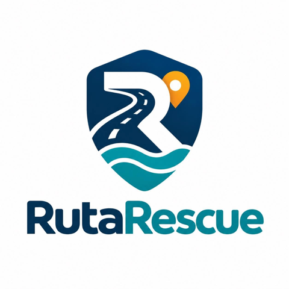</p>

# RutaRescue

A flood-preparedness and safer-route app for Metro Manila, built as a native Android app in Java and XML.

> RutaRescue supports decisions; it never calls a route "safe", and in an emergency you should call 911.

## Run it

- Open this folder in Android Studio and press **Run**; the app connects to the team's Firebase project, so you can sign in or create a resident account.
- Live traffic needs a TomTom key in `local.properties` (`TOMTOM_API_KEY=...`); without one, routes use free OpenStreetMap routing.

## Ad

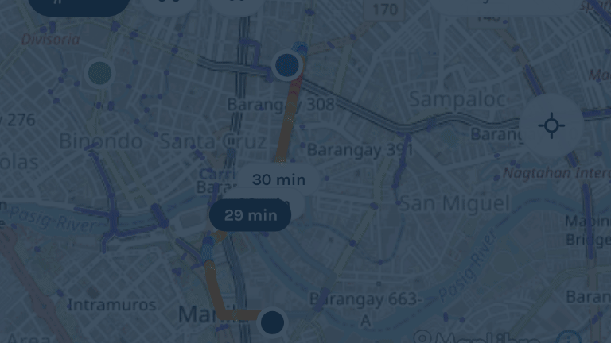

## Screens

Real screens from the Android emulator, using made-up demo data (one resident name is hidden).

### Residents

| Home | Evacuation centers | Ranked routes |
|:---:|:---:|:---:|
| 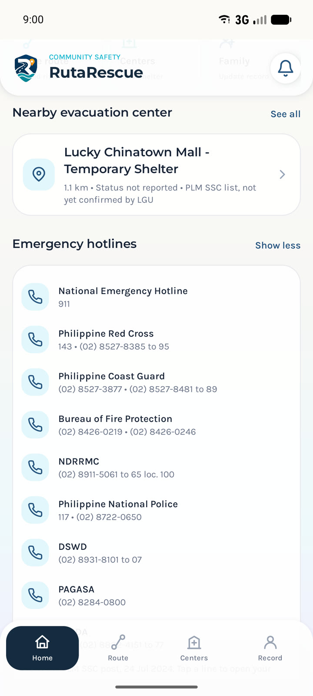 | 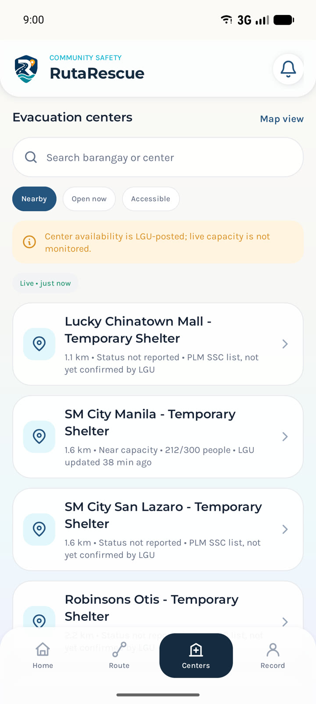 | 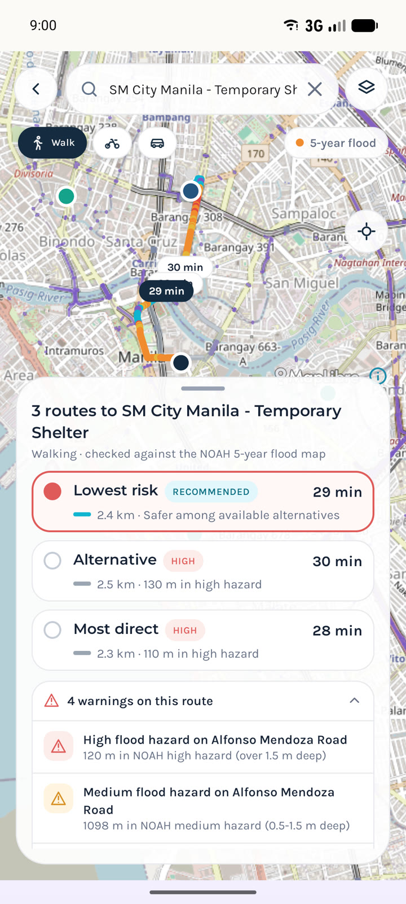 |
| **Center capacity** | **My Record** | **Ligtas Priority application** |
| 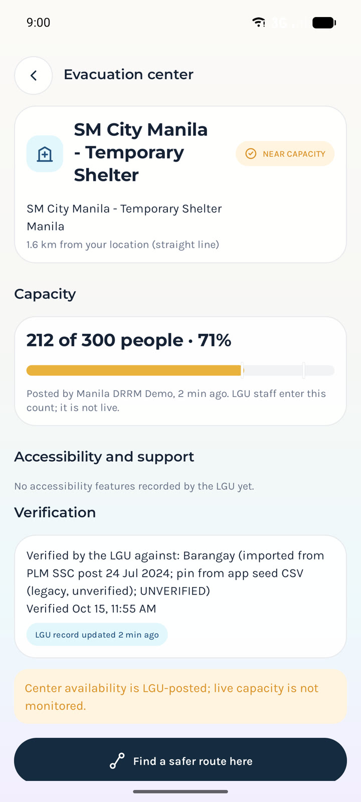 | 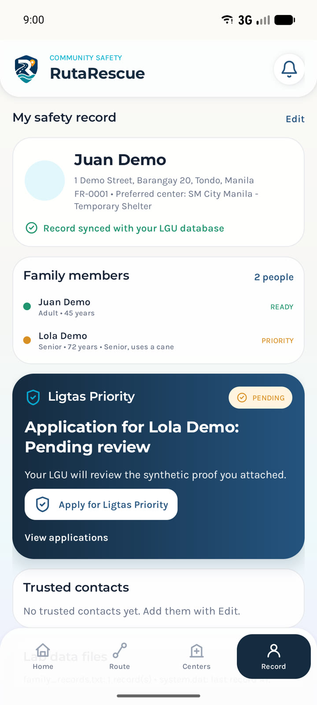 | 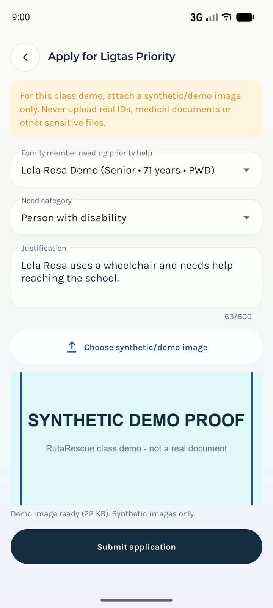 |

### LGU operations

| Operations overview | Ligtas reviews | Review an application |
|:---:|:---:|:---:|
| 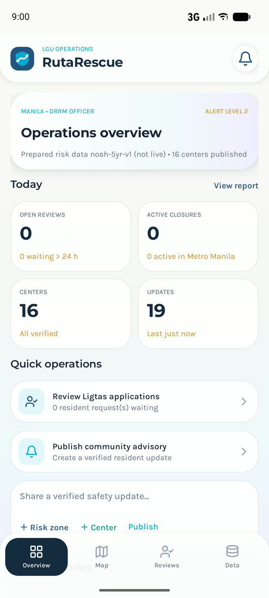 | 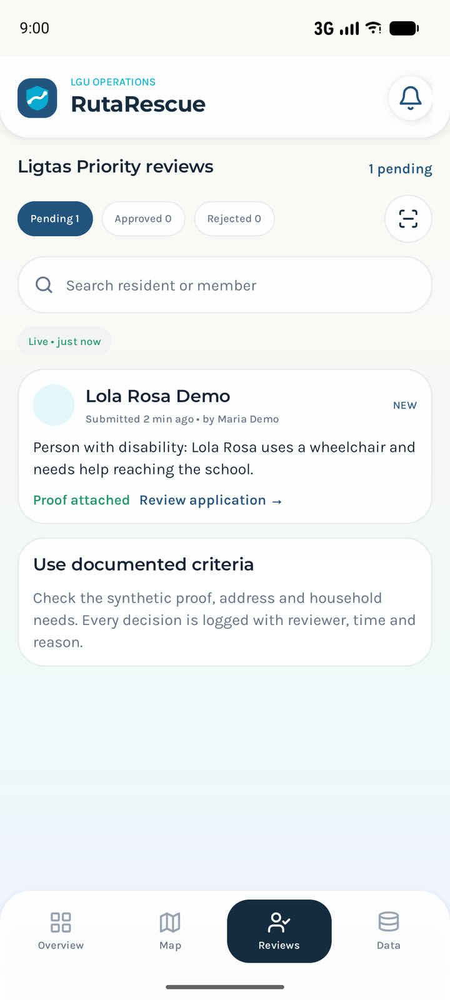 | 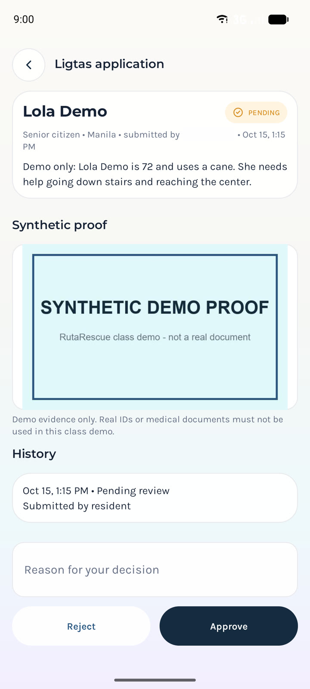 |
| **Data and centers** | **Center capacity** | **Operations map** |
| 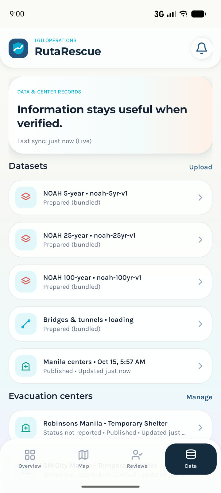 | 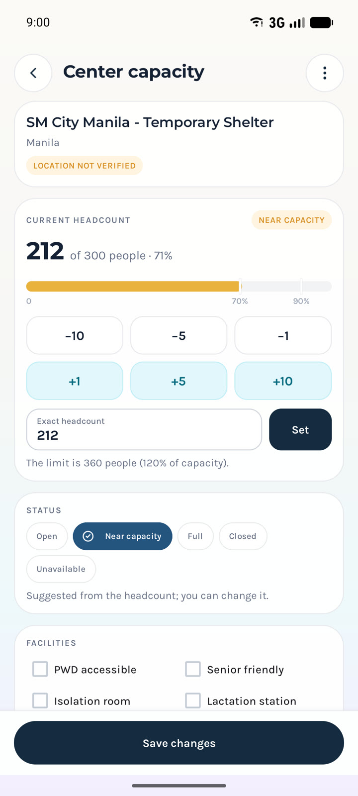 | 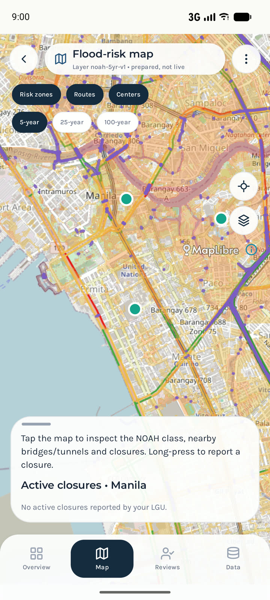 |

---

## The concept

- **Problem:** Floods cut off roads, and residents rarely know which route to an evacuation center is least exposed.
- **Idea:** The app checks each route against official flood-hazard maps and ranks the options by risk.
- **Users:** Residents plan routes and keep a family record, moderators run one evacuation center each, and the LGU announces and approves.

## What residents can do

- Keep a family evacuation record that works offline.
- Compare up to three routes against the 5-, 25- and 100-year flood scenarios.
- See nearby evacuation centers every day, even before the LGU has confirmed them.
- Check each center's latest headcount posted by the LGU.
- Call emergency hotlines straight from Home.
- Apply for Ligtas Priority assistance and show its status as a QR code.
- See the city's alert level and the newest advisories first on Home.
- Get a priority ID with a QR code at sign-up as a senior citizen, person with disability or pregnant resident.
- Change the password, notifications and sync from Settings.

## What moderators can do

- Run one evacuation center and keep its headcount, status and facilities up to date.
- See every center of the city with how full it is.
- Send advisories about their center to the LGU and rewrite one the LGU declined.
- Scan a resident's priority ID and mark missing documents.
- Review Ligtas Priority applications.

## What the LGU can do

- Set the city's alert level.
- Accept or decline the moderators' advisories and publish its own.
- Report road closures and confirm whether bridges and tunnels are open.
- Add, import, verify and publish evacuation centers.
- Approve staff sign-ups and choose the center each moderator runs.

---

## How the code works

### Startup

- `RutaRescueApp` creates one `AppContainer`, which builds every repository, service and route provider in one place.

### Sign-in and roles

- `AuthService` signs the user in with Firebase Auth.
- `SessionManager` loads the user's profile and role from Firestore.
- `MainShellActivity` shows the resident, moderator or LGU tabs based on that role.
- `ModeratorProfile` and `LguProfile` answer every "may I?" question, such as `canManageCenter()` or `canSetAlertLevel()`.

### Family record

- `FamilyRecord` and `FamilyMember` check every value through `RecordValidator` before it is stored.
- `FamilyService` saves the record to Firestore and mirrors it to `family_records.txt` (`FamilyTextFileStore`).
- `SystemStateStore` updates `system.dat` with the last record number.

### Finding a safer route

1. `SafeRouteFragment` calls `RouteService.findRoutes()` on a background thread.
2. Online, `FallbackRouteProvider` asks TomTom first and falls back to OpenStreetMap (OSRM).
3. Offline, `CachedRouteProvider` reuses routes saved by `RouteCacheStore`.
4. `RouteSampler` cuts each route into 10 m samples.
5. `RiskEngine` runs five `RiskRule`s on each sample: `ClosureRule`, `TunnelRule`, `BridgeRule`, `UnknownStructureRule`, then `SurfaceRule`.
6. `RouteRanker` puts open routes first, then the lowest hazard, the shortest flooded distance, the fewest unverified structures and the shortest time.
7. `RouteExplainer` writes the plain-language reasons shown on each route card.
8. If every route crosses a closure, `ClosureAvoidance` asks TomTom for detours through `AvoidingRouteProvider`.

| Example | Result |
|---|---|
| Ordinary road over a HIGH flood zone | RED |
| Unverified bridge over a HIGH flood zone | AMBER |
| Bridge closed by the LGU | UNAVAILABLE |
| Bridge confirmed open by the LGU | GREEN |

### Flood data

- `AssetHazardRepository` checks each bundled flood grid against its SHA-256 hash in `manifest.json` before loading it.
- `HazardGrid` answers "how flooded is this point?" for the chosen 5-, 25- or 100-year scenario.

### Evacuation centers and hotlines

- `BundledCenterReader` loads the 91 PLM SSC centers that ship with the app.
- `CenterService.withBundled()` adds them to the LGU's published centers, and an LGU center with the same name and city replaces its bundled copy.
- `CenterCapacity` refuses a headcount above 120% of capacity and gives residents a line like "212 of 300 people · 71%".
- `HotlineReader` loads the nine emergency hotlines, and `Hotline.dialDigits()` turns a printed number into what the phone dials.

### Ligtas Priority and priority IDs

- `LigtasService.submit()` stores the application with its synthetic proof image.
- `LigtasService.decide()` saves the moderator's decision and its `AuditEvent` together in one Firestore batch.
- `PriorityIdService.issue()` creates a priority ID whose QR holds only a random code.
- `PriorityCard.recordCheck()` stores the moderator's OK or Missing for each checklist item.

### Advisories and the alert level

- `CityAlertService.set()` lets only the city's LGU change its alert level.
- `Advisory` moves a moderator's update from Pending to Approved or Declined, and a declined one can never be published.
- `SafeRouteFragment` plans routes again when the LGU posts or lifts a road closure.

### Offline and sync

- Firestore's offline cache keeps the latest records, centers and advisories on the phone.
- `ConnectivityMonitor` shows the offline banner when the connection drops.
- `SyncWorker` refreshes advisories and centers about once an hour through WorkManager.
- `FieldValues` reads every Firestore field leniently, so a value typed by hand in the console never crashes the app.

---

## Architecture (MVC + OOP)

```
app/src/main/java/com/rutarescue/
├── model/         Entities with private fields and validated setters
├── validation/    Rules for names, phone numbers and record IDs
├── exception/     Custom checked exceptions
├── persistence/   Lab files (family_records.txt, system.dat) and the route cache
├── risk/          Route-risk engine: rules, sampler, ranker, explainer
├── network/       TomTom and OpenStreetMap clients
├── repository/    Data interfaces with Firestore and local versions
├── service/       Use cases: sign-in, family, routes, Ligtas, data, sync
└── ui/            Activities and Fragments, grouped by role
app/src/main/res/layout/   XML views
```

| OOP concept | Where it shows |
|---|---|
| Encapsulation | `FamilyRecord` and `LigtasApplication` change only through validated methods. |
| Inheritance | `ModeratorProfile` and `LguProfile` extend `StaffProfile`, which extends `UserProfile`. |
| Polymorphism | Each staff profile answers the permission checks its own way, and five `RiskRule` classes score a route their own way. |
| Abstraction | `RouteProvider` hides whether TomTom, OpenStreetMap or the cache answers. |

| Lab | Concept | File |
|---|---|---|
| Lab 5 | Record IDs and a binary `system.dat` | `RecordValidator`, `SystemStateStore` |
| Lab 6 | A pipe-delimited `family_records.txt` with custom exceptions | `FamilyTextFileStore`, `InvalidFamilyRecordException` |
| Lab 7 | Name formatting, phone rules, duplicate IDs and safe saves | `NameFormatter`, `PhoneNumber`, `AtomicFileWriter` |

---

## More documentation

- [Roles, requirements, use cases, OOP and MVC](docs/ARCHITECTURE_roles_oop_mvc.md)
- [Plain-language walkthrough](docs/WALKTHROUGH.md)
- [Latest change log](docs/CHANGES_2026-10-22_role-workflows.md)

---

## Tech stack

| Part | Tool |
|---|---|
| App | Java, XML layouts, Material Components |
| Built and run with | Android Studio and the included Gradle wrapper |
| Accounts and database | Firebase Auth, Firestore and Storage |
| Map | MapLibre with OpenStreetMap tiles |
| Routing | TomTom with live traffic, with OpenStreetMap (OSRM) as a free fallback |
| Place search | OpenStreetMap Nominatim |
| Flood data | UP NOAH 5-, 25- and 100-year flood maps |
| Design | Built to match the team's Figma file exactly |
| Tests | 237 unit tests and 20 database security-rule tests |

## Bundled data

| Data | What it holds |
|---|---|
| `flood_data/` | Flood overlays and hazard grids for each scenario, checked by SHA-256 before use. |
| `structures/` | 5,023 bridges and 240 tunnels from OpenStreetMap, unverified until an LGU confirms them. |
| `seed/` | 91 PLM SSC evacuation centers (Jul 2024) shown every day, plus 90 from the old app, all unverified until an LGU confirms them. |
| `seed/hotlines_plmssc_2024.json` | Nine emergency hotlines from the same PLM SSC post, with its mixed-up labels corrected. |
| `data/raw/` (repo root) | The raw NOAH shapefiles and OpenStreetMap export that `tools/dataprep` turns into the files above. |

---

## Security and privacy

- Database rules enforce each user's role and city.
- The Firebase settings file (`app/google-services.json`) is shared on purpose, because `firebase/firestore.rules` decides who may read or change each record.
- The TomTom key stays in each computer's `local.properties` and is never uploaded.
- Every LGU change writes a permanent audit record.
- Ligtas Priority uses sample images only, never real IDs or medical files.
- QR codes hold only an application number or a random priority-ID code.
- Signing out wipes the family file and cached routes from a shared phone.
- No personal data or keys are written to the logs.

## Offline behaviour

- Flood maps and bridge data ship inside the app, so they work without signal.
- Each list shows whether its data is Live, Cached, Stale or Prepared.
- Changes made offline upload once the phone reconnects.

## Known limitations

- Flood maps are modelled scenarios, not live water levels.
- OpenStreetMap bridge and tunnel data may be incomplete.
- Evacuation-center capacity is only as fresh as the LGU's last update.
- Bundled center pins are approximate until an LGU verifies each center.
- The first route search needs an internet connection.

## Data credits

- **Flood hazard maps:** UP NOAH Center (Project NOAH)
- **Bridges, tunnels, basemap, search and fallback routing:** © OpenStreetMap contributors (ODbL), Nominatim, OSRM
- **Navigation and live traffic:** © TomTom
- **Map rendering:** MapLibre Native
