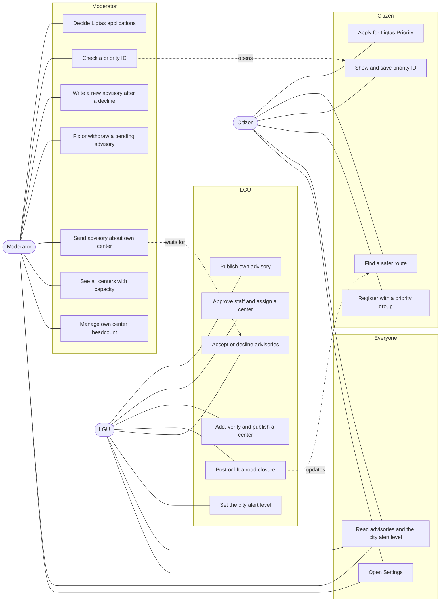
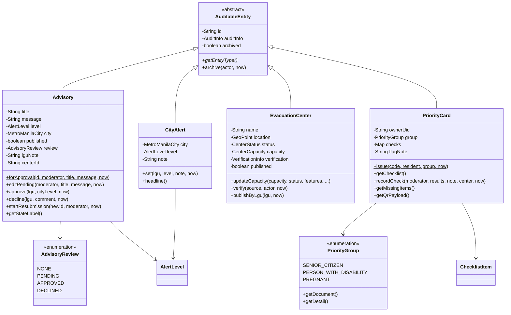
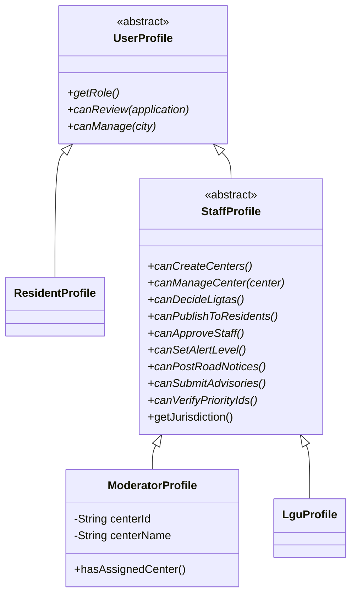
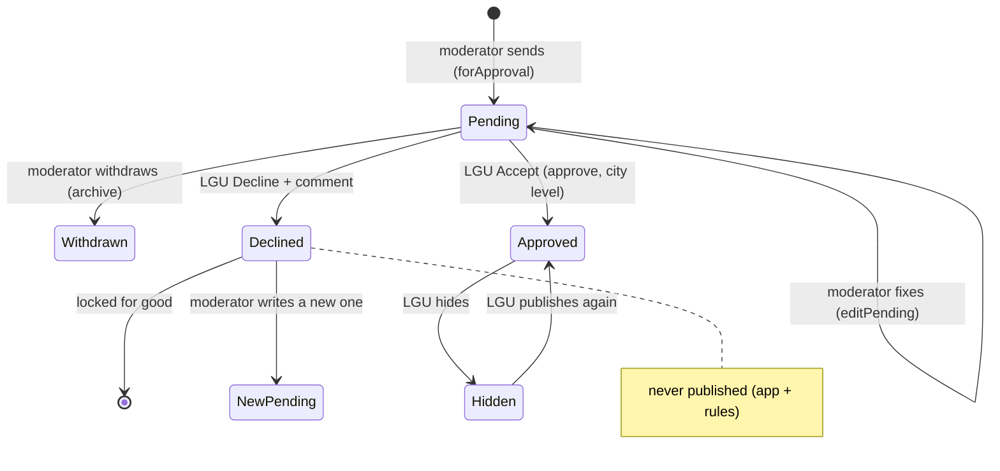
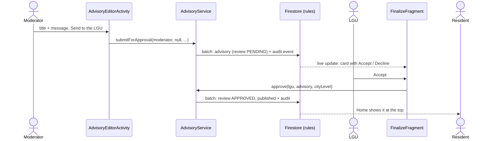
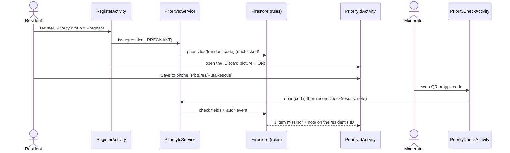
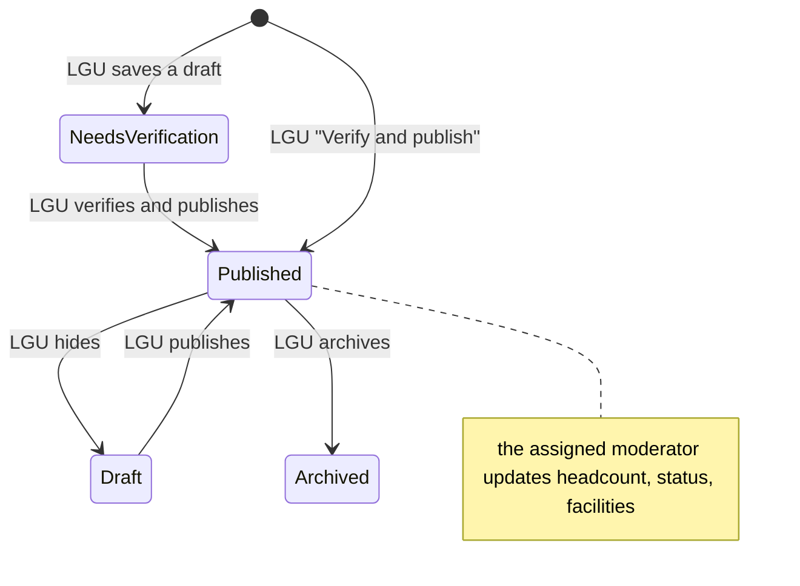

# RutaRescue — roles, requirements, OOP and MVC (updated 2026-10-22)

This document updates the requirements, use cases and diagrams of the project design (DOCX
sections 3, 4, 5, 6, 10, 12 and 13) for the role workflows added on 2026-10-22, and explains how
the code applies object-oriented design and MVC. The diagrams are Mermaid; GitHub draws them.

Contents: 1 Roles · 2 Requirements · 3 Use cases · 4 OOP design · 5 MVC map · 6 Diagrams ·
7 Security rules map

---

## 1. Roles at a glance

| Role | Who | Main job | Tabs |
|---|---|---|---|
| **Citizen (resident)** | Anyone who registers | Plan safer routes, keep a family record, apply for Ligtas Priority, carry a priority ID | Home · Route · Centers · Record |
| **Moderator** | City staff at ONE evacuation center | Headcount of their center, priority ID checks, Ligtas decisions, advisories about their center (sent to the LGU) | Overview · Centers · Reviews |
| **LGU** | City disaster office | Sets the alert level, posts road closures, creates and publishes centers, accepts or declines advisories, approves staff and assigns moderators to centers | Overview · Map · Finalize · Data |

Every staff account is locked to the city chosen at staff sign-up, and every account has a
**Settings** screen (gear in the header).

---

## 2. Requirements

"FR" = functional requirement. New or changed on 2026-10-22 are marked **(new)** / **(changed)**.

### 2.1 General

| ID | Requirement |
|---|---|
| FR-G1 **(new)** | Every account has a Settings screen: account details, password reset e-mail, phone notifications, Sync now, About, Sign out; residents also see their priority ID. |
| FR-G2 **(new)** | The first screen of every role starts with the advisories: the city's alert level, then the 3 newest advisories, then "See all". |
| FR-G3 | Advisories older than 30 days are hidden from lists (kept in the records). |

### 2.2 LGU

| ID | Requirement |
|---|---|
| FR-L1 **(new)** | Only the LGU of a city sets the city's alert level (Advisory, Alert level 1, 2, 3) with an optional note; residents, moderators and other cities cannot. |
| FR-L2 **(new)** | The LGU has an approval queue of the moderators' advisories, each with Accept and Decline. Accept publishes it to residents at once with the city's alert level. Decline requires a comment (5–300 characters) that the moderator reads. |
| FR-L3 **(changed)** | Only the LGU posts or lifts road closures and bridge/tunnel status. |
| FR-L4 **(new)** | When the LGU posts or lifts a closure, residents' route suggestions update by themselves to avoid closed roads (routes on screen and during guidance). |
| FR-L5 **(changed)** | Only the LGU adds, imports, edits, verifies, publishes and archives evacuation centers. A published center must be verified against a named source. |
| FR-L6 **(changed)** | The LGU approves staff sign-ups of its city; a moderator is approved together with the center they will run, and the LGU can change a moderator's center later. |
| FR-L7 | The LGU writes and publishes its own city-wide advisories, hides or archives any advisory of its city, and never publishes a declined one. |
| FR-L8 **(new)** | Tapping a moderator shows a dashboard of their center: capacity (chart), headcount and last update, facilities, the city alert level, the NOAH flood hazard at the center for each scenario, the center's advisories, and the moderator's activity and work by kind. |

### 2.3 Moderator

| ID | Requirement |
|---|---|
| FR-M1 **(changed)** | A moderator cannot add centers (no "Add center"). |
| FR-M2 **(new)** | "Manage Center" is the moderator's main view: the Overview shows their own center with its headcount and a "Manage center" button. |
| FR-M3 **(new)** | The moderator Overview starts with the advisories (FR-G2): the city's published ones plus their own center's pending or declined ones. |
| FR-M4 **(new)** | A moderator writes advisories about their own center only and sends them to the LGU: Pending → Approved (published) or Declined. Residents never see a pending or declined advisory. A pending one can be fixed or withdrawn; a declined one cannot be changed or published and shows the LGU's comment; the moderator writes a new one (it may start from the old text). |
| FR-M5 **(new)** | The moderator's map is replaced by a list of the city's evacuation centers, each with its current capacity. |
| FR-M6 **(changed)** | A moderator changes only the headcount, status and facilities of their own center; other centers are read-only. |
| FR-M7 | A moderator decides Ligtas applications of their city (Approved, Needs documents, Rejected) and may change a decision later with a message. |
| FR-M8 **(new)** | A moderator scans a resident's priority ID (or types its code), sees the record and a checklist of required documents and details, marks each item OK or Missing, adds a note, and saves the check. |

### 2.4 Citizen (resident)

| ID | Requirement |
|---|---|
| FR-C1 **(new)** | Home starts with the advisories and the city's alert level (FR-G2). |
| FR-C2 **(new)** | At registration a resident may choose a priority group (Senior citizen, Person with disability, Pregnant). |
| FR-C3 **(new)** | A resident in a priority group gets a priority ID with a QR code, shown right after registration, which they can save to the phone as a picture. The QR holds only a random code, never personal data. |
| FR-C4 **(new)** | The resident sees what to bring to the center and, after a check, what is missing and the moderator's note. |
| FR-C5 | Route suggestions rank routes through a closed road last and look for detours when every route is closed. |
| FR-C6 | Ligtas Priority applications, status notifications and "Send new documents" work as before. |

### 2.5 Non-functional

| ID | Requirement |
|---|---|
| NFR-1 | Every rule above is enforced by the Firestore security rules, not only by hidden buttons (20 emulator tests). |
| NFR-2 | Every staff change is saved together with an audit event in the same batch; audit events can never be edited or deleted. |
| NFR-3 | Priority IDs: a moderator can open one card by its code but cannot list cards; the audit text has no names. |
| NFR-4 | Screens fit small phones and large text (checked at 720 x 1280, text 130%). |
| NFR-5 | Code stays undergraduate-readable OOP (no frameworks beyond Android, Firebase and Material). |

---

## 3. Use cases

### 3.1 Use-case diagram



### 3.2 Use-case descriptions (new or changed)

| UC | Actor | Pre-condition | Main flow | Rules / alternatives |
|---|---|---|---|---|
| UC-1 Set alert level | LGU | Signed in as the city's LGU | Overview → alert strip → Change → choose level → optional note → saved | Moderators and residents see it read-only; other cities' LGUs are refused (FR-L1). |
| UC-2 Send center advisory | Moderator | Assigned to a center | Overview → Write a center update → title, message → Send to the LGU → shows "Pending approval" | No alert level field; without a center the button explains that the LGU must assign one (FR-M4). |
| UC-3 Accept / decline advisory | LGU | A pending advisory exists | Finalize → card → Accept → confirm → published with the city level; or Decline → comment → saved | A declined advisory can never be published (rules) (FR-L2). |
| UC-4 Rewrite a declined advisory | Moderator | Their advisory was declined | See all advisories → declined card (comment shown) → Write a new advisory → edited text → Send | The declined one stays as it is (FR-M4). |
| UC-5 Manage own center | Moderator | Assigned to a center | Overview → Manage center → ± buttons or exact count, status, facilities → Save | Other centers open read-only; capacity above 120% is refused (FR-M6). |
| UC-6 Add a center | LGU | — | Data → Manage → Add a center → details, pin → verification source → Verify and publish | Then assign its moderator in Finalize (FR-L5). |
| UC-7 Approve staff / assign center | LGU | A sign-up is pending | Finalize → request → Approve → (moderator) choose the center | Change later under "Moderators and their centers" (FR-L6). |
| UC-8 Post a closure | LGU | — | Map → report a closure → saved | Residents' routes re-plan automatically (FR-L3, FR-L4). |
| UC-9 Register with a priority group | Citizen | — | Create account → Priority group = Pregnant (etc.) → Register → priority ID opens → Save to phone | If saving the ID fails (no signal), the account still works; "Get a priority ID" in Settings (FR-C2, FR-C3). |
| UC-10 Check a priority ID | Moderator | Resident shows the ID | Overview or Reviews → Check a priority ID → Scan QR (or type code) → record + Ligtas status → mark each item OK/Missing → note → Save check | Every item must be marked; the resident sees the result (FR-M8, FR-C4). |
| UC-11 Settings | Everyone | Signed in | Gear → Settings | Residents also see the priority ID row (FR-G1). |

### 3.3 New acceptance journeys (continue DOCX section 13)

| AJ | Journey | Result |
|---|---|---|
| AJ-14 | Moderator sends a center update; LGU accepts it | Residents see it on Home with the city's alert level |
| AJ-15 | LGU declines with a comment; moderator writes a new one | Declined one stays declined; the new one is pending |
| AJ-16 | LGU raises Manila to Alert level 2 | Every Manila account sees "Alert level 2 • Manila" at the top |
| AJ-17 | Resident registers as Pregnant | Priority ID opens; Save to phone writes Pictures/RutaRescue/…png |
| AJ-18 | Moderator types the ID code, marks one document Missing | Resident's ID screen shows "1 item missing" and the note |
| AJ-19 | LGU posts a closure while a resident compares routes | Routes are planned again with a "Routes updated" message |

---

## 4. Object-oriented design

### 4.1 Encapsulation — objects guard their own rules

| Class | What is hidden | How it is changed |
|---|---|---|
| `Advisory` | `review`, `published`, `level`, `lguNote` are private | Only through `forApproval()`, `editPending()`, `approve(lgu, cityLevel)`, `decline(lgu, comment)`, `publish()`, `startResubmission()`. Each checks the state (e.g. a DECLINED advisory throws on `publish()`). |
| `CityAlert` | `level`, `note`, `setAt` | Only `set(lgu, level, note)`, which checks `lgu.canSetAlertLevel()` and the city. |
| `PriorityCard` | the `checks` map, `flagNote`, `checkedBy` | Only `recordCheck(moderator, results, note, center)`, which requires every checklist item to be OK or Missing. `getChecks()` returns a read-only view. |
| `StaffRequest` | `status`, the assigned center | `approve(lgu, centerId, centerName)` / `reject(lgu, reason)`; a moderator cannot be approved without a center. |
| `EvacuationCenter` | capacity, status, publication | `updateCapacity(...)`, `verify(...)`, `publishByLgu(...)`; a center must be verified before it is published. |

### 4.2 Inheritance — "is a" relationships

```
UserProfile (abstract)
├── ResidentProfile
└── StaffProfile (abstract, city-locked)
    ├── ModeratorProfile   (+ assigned center)
    └── LguProfile

AuditableEntity (abstract: id, audit info, archive)
├── Advisory        ├── EvacuationCenter   ├── LigtasApplication
├── StaffRequest    ├── CityAlert (new)    └── PriorityCard (new)
```

A moderator **is** a staff member, who **is** a user; an advisory, a city alert and a priority ID
**are** auditable records, so they share the id, audit trail and archive behaviour written once.

### 4.3 Polymorphism — the profile answers "may I?"

`StaffProfile` declares abstract permission methods; each subclass answers differently, and
screens and services only ask the profile:

| Method | `ModeratorProfile` | `LguProfile` |
|---|---|---|
| `canCreateCenters()` | false | true |
| `canManageCenter(center)` | true only for **its own** center | false |
| `canDecideLigtas()` | true | false |
| `canPublishToResidents()` | false | true |
| `canApproveStaff()` | false | true |
| `canSetAlertLevel()` | false | true |
| `canPostRoadNotices()` | false | true |
| `canSubmitAdvisories()` | true once a center is assigned | false |
| `canVerifyPriorityIds()` | true | false |

Examples: `CenterCapacityActivity` is editable only when `staff.canManageCenter(center)`;
`DatasetService.reportClosure()` refuses unless `staff.canPostRoadNotices()`; `MainShellActivity`
builds the moderator's three tabs or the LGU's four. `FirestoreStaffRepository.staff(doc)` picks the
subclass from the stored role, so the rest of the app never checks a role string. Other
polymorphism already in the app: the five `RiskRule`s and the three `ChartView`s.

### 4.4 Abstraction — what, not how

- **Repository interfaces** (`AdvisoryRepository`, `CityAlertRepository`, `PriorityCardRepository`,
  `StaffRepository`, `CenterRepository`…) say *what* is stored; the `Firestore…Repository` classes
  hide *how* (collections, batches, audit events). Unit tests use fakes.
- **Services** (`AdvisoryService`, `CityAlertService`, `PriorityIdService`, `StaffService`,
  `CenterService`, `DatasetService`) are the use cases the screens call.
- **Abstract classes** `UserProfile`, `StaffProfile`, `AuditableEntity` define the common shape;
  `PriorityGroup` is an enum where each group carries its own document and detail to check, so a
  new group is one new constant.

### 4.5 How Advisory and Center are structured





---

## 5. MVC map

The app is MVC: **Models** are plain Java classes (`model/`), **Views** are the XML layouts
(`res/layout/`) and a few custom Views, **Controllers** are the Activities and Fragments
(`ui/`), which call **services** (use cases) that use **repositories** (data). Controllers never
talk to Firebase directly (`AppContainer` hands them the services).

| Feature | Model | View (XML) | Controller | Service → Repository |
|---|---|---|---|---|
| Settings | `UserProfile`, `PriorityCard` | `activity_settings.xml`, `item_data_row.xml` | `SettingsActivity` | `AuthService`, `PriorityIdService` |
| Alert level | `CityAlert`, `AlertLevel` | `view_alert_strip.xml` | `LguOverviewFragment`, `ModeratorOverviewFragment`, `HomeFragment` (via `AlertStrip`) | `CityAlertService` → `FirestoreCityAlertRepository` |
| Advisory approval | `Advisory`, `AdvisoryReview` | `item_advisory_review.xml`, `item_advisory.xml`, `activity_advisory_editor.xml` | `FinalizeFragment`, `AdvisoryEditorActivity`, `AdvisoryListActivity` | `AdvisoryService` → `FirestoreAdvisoryRepository` |
| Moderator overview | `ModeratorProfile`, `EvacuationCenter` | `fragment_moderator_overview.xml` | `ModeratorOverviewFragment` | `CenterService`, `AdvisoryService`, `LigtasService` |
| Centers list (moderator) | `EvacuationCenter`, `CenterCapacity` | `fragment_moderator_centers.xml`, `item_center_load.xml` | `ModeratorCentersFragment` | `CenterService` → `FirestoreCenterRepository` |
| Manage center | `EvacuationCenter`, `CenterCapacity` | `activity_center_capacity.xml` | `CenterCapacityActivity` | `CenterService.updateCapacity` → `saveCapacity` |
| Centers (LGU) | `EvacuationCenter` | `activity_center_editor.xml`, `fragment_lgu_data.xml` | `CenterEditorActivity`, `LguDataFragment` | `CenterService.verifyAndPublish`, `DatasetService.publishCenters` |
| Staff and centers | `StaffRequest`, `ModeratorProfile` | `fragment_lgu_finalize.xml` | `FinalizeFragment` | `StaffService` → `FirestoreStaffRepository` |
| Moderator dashboard (LGU) | `ModeratorProfile`, `EvacuationCenter`, `PointHazard`, `AuditEvent` | `activity_moderator_dashboard.xml` (ring, bar and column charts) | `ModeratorDashboardActivity` | `CenterService`, `HazardQueryService.inspectAll`, `AuditRepository`, `AdvisoryService`, `CityAlertService` |
| Road closures | `RoadClosure` | `dialog_closure.xml` | `LguHazardMapFragment` (LGU), `SafeRouteFragment` (re-plans) | `DatasetService`, `RouteService` |
| Priority ID (resident) | `PriorityCard`, `PriorityGroup` | `activity_register.xml`, `activity_priority_id.xml` | `RegisterActivity`, `PriorityIdActivity` (+ `PriorityIdCardRenderer`) | `PriorityIdService` → `FirestorePriorityCardRepository` |
| Priority ID check | `PriorityCard`, `ChecklistItem`, `CheckResult` | `activity_priority_check.xml`, `item_check_row.xml` | `PriorityCheckActivity`, `QrCheck` | `PriorityIdService`, `LigtasService` |

---

## 6. Diagrams

### 6.1 Advisory review states



### 6.2 Moderator sends, LGU decides



### 6.3 Priority ID from registration to the center



### 6.4 Closure posted, routes re-planned

```mermaid
sequenceDiagram
    actor LGU
    participant Map as LguHazardMapFragment
    participant DS as DatasetService
    participant DB as Firestore
    participant SR as SafeRouteFragment
    participant RS as RouteService
    LGU->>Map: report a closure
    Map->>DS: reportClosure(...) (LGU only)
    DS->>DB: closure + audit event
    DB-->>SR: closures listener: the set changed
    SR->>RS: findRoutes(...) again
    RS->>RS: ClosureRule ranks closed routes last; detours if all closed
    RS-->>SR: new comparison + "Routes updated" message
```

### 6.5 Center states (staff)



---

## 7. Security rules map (`firebase/firestore.rules`)

| Collection | Read | Write |
|---|---|---|
| `cityAlerts/{CITY}` | everyone signed in | that city's LGU, with an audit event |
| `advisories` | published: everyone; others: staff of the city | LGU of the city (never publishes a DECLINED one); moderator: creates PENDING for their own center with level ADVISORY, edits only while PENDING |
| `centers` | published: everyone; others: staff of the city | LGU of the city (create, edit, publish, archive); the center's moderator: headcount, status and facility fields only |
| `closures`, `structureStatus`, `datasetVersions` | everyone signed in | LGU of the city only |
| `lgu_staff` | self, LGU of the city | LGU approves a sign-up (a moderator with a center of the city) and changes a moderator's center |
| `priorityIds` | owner; any moderator by code (get only, no list) | owner creates unchecked; a moderator records the check (check fields only, audit event) |
| `auditEvents` | staff of the city | staff of their own city, append-only |
